<div align="center">

# 🦁 XXD Shop 002 | Signature Dish Main Image

### Remember the name, crave the food, place the order

<a href="README.md">简体中文</a> · <strong>English</strong>

</div>

> Original brief: [Simplified Chinese original](references/original-prompt/zh-CN.md) · [English reading translation](references/original-prompt/en.md)

<!-- xxd-samples:start -->
## Samples

<p align="center"><a href="assets/examples/s01-size-1x1-1254x1254.png">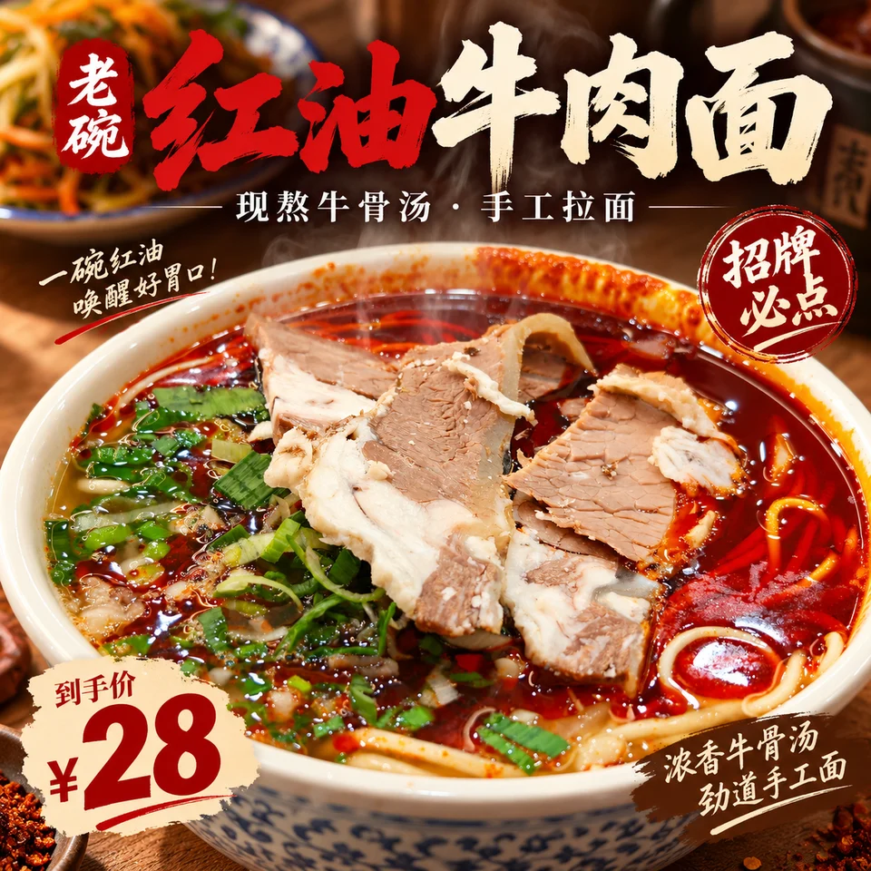</a><br><sub>Delivery-app image · 1:1 · 1254x1254<br>LAOWAN chilli-oil beef noodles · <a href="assets/examples/sources/beef-noodle.jpg">source photo</a> · brief-generated (Chinese)</sub></p>

### One product, every placement

Same product, same brief: each ratio is a new composition, not a crop.

<table>
<tr><td align="center" valign="top"><a href="assets/examples/s01-size-1x1-1254x1254.png"></a><br><sub>Delivery-app image · 1:1 · 1254x1254<br>LAOWAN chilli-oil beef noodles · <a href="assets/examples/sources/beef-noodle.jpg">source photo</a> · brief-generated (Chinese)</sub></td><td align="center" valign="top"><a href="assets/examples/s02-size-3x4-1086x1448.png">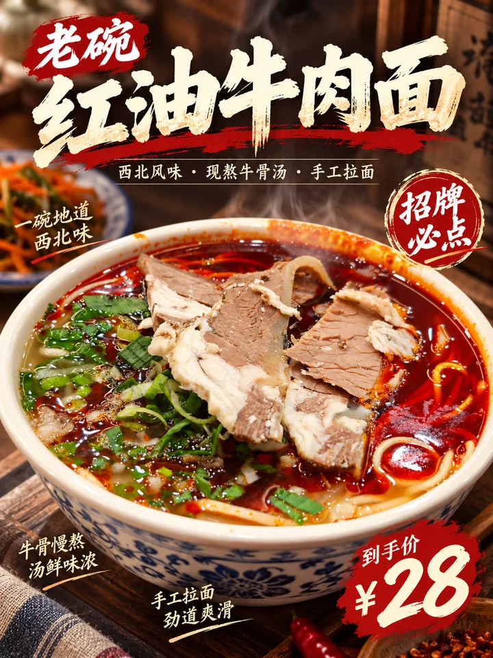</a><br><sub>Menu feature · 3:4 · 1086x1448<br>LAOWAN chilli-oil beef noodles · <a href="assets/examples/sources/beef-noodle.jpg">source photo</a> · brief-generated (Chinese)</sub></td><td align="center" valign="top"><a href="assets/examples/s03-size-9x16-941x1672.png">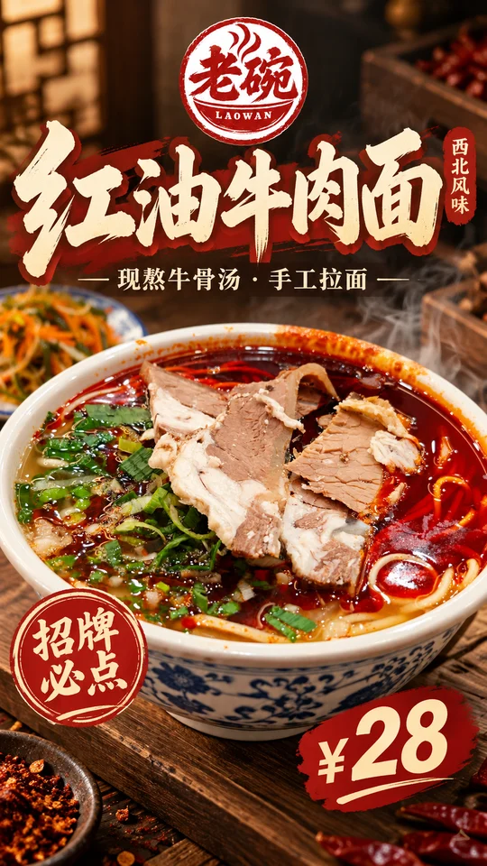</a><br><sub>Store vertical screen · 9:16 · 941x1672<br>LAOWAN chilli-oil beef noodles · <a href="assets/examples/sources/beef-noodle.jpg">source photo</a> · brief-generated (Chinese)</sub></td><td align="center" valign="top"><a href="assets/examples/s04-size-16x9-1672x941.png">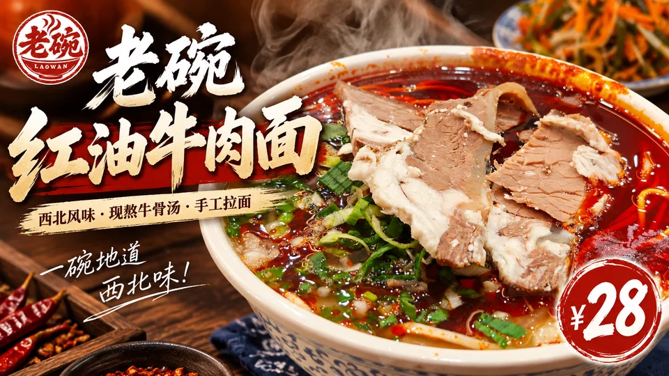</a><br><sub>Storefront lightbox · 16:9 · 1672x941<br>LAOWAN chilli-oil beef noodles · <a href="assets/examples/sources/beef-noodle.jpg">source photo</a> · brief-generated (Chinese)</sub></td></tr>
</table>

### Across categories

<table>
<tr><td align="center" valign="top"><a href="assets/examples/c01-category-1x1-1254x1254.png">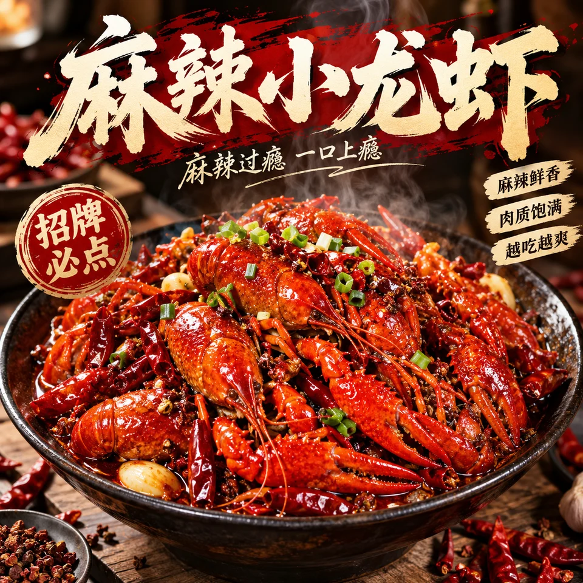</a><br><sub>Delivery-app image · 1:1 · 1254x1254<br>Spicy crayfish · name only · brief-generated (Chinese)</sub></td><td align="center" valign="top"><a href="assets/examples/c02-category-3x4-1086x1448.png"></a><br><sub>Menu feature · 3:4 · 1086x1448<br>Bubble milk tea · name only · brief-generated (Chinese)</sub></td><td align="center" valign="top"><a href="assets/examples/c03-category-1x1-1254x1254.png">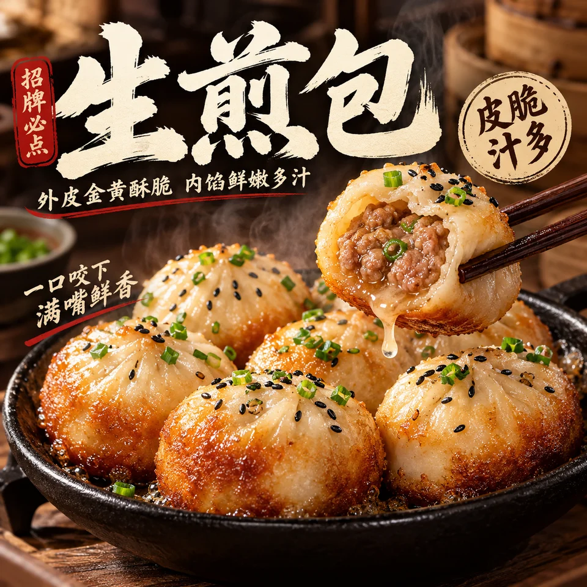</a><br><sub>Delivery-app image · 1:1 · 1254x1254<br>Pan-fried buns · name only · brief-generated (Chinese)</sub></td></tr>
<tr><td align="center" valign="top"><a href="assets/examples/c04-category-4x5-1122x1402.png">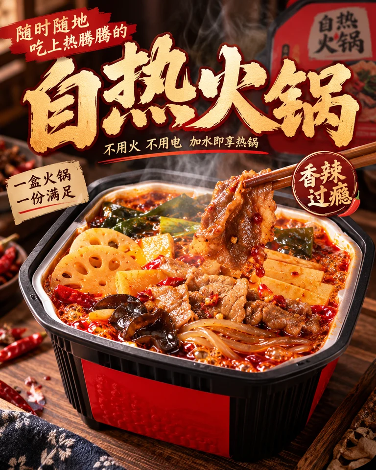</a><br><sub>Listing image · 4:5 · 1122x1402<br>Self-heating hot pot · name only · brief-generated (Chinese)</sub></td><td align="center" valign="top"><a href="assets/examples/c05-category-16x9-1672x941.png"></a><br><sub>Storefront lightbox · 16:9 · 1672x941<br>Salmon sushi platter · name only · brief-generated (Chinese)</sub></td><td align="center" valign="top"><a href="assets/examples/c06-category-9x16-941x1672.png"></a><br><sub>Store vertical screen · 9:16 · 941x1672<br>Coconut latte · name only · copy plan (Chinese)</sub></td></tr>
<tr><td align="center" valign="top"><a href="assets/examples/s05-category-3x4-1086x1448.png">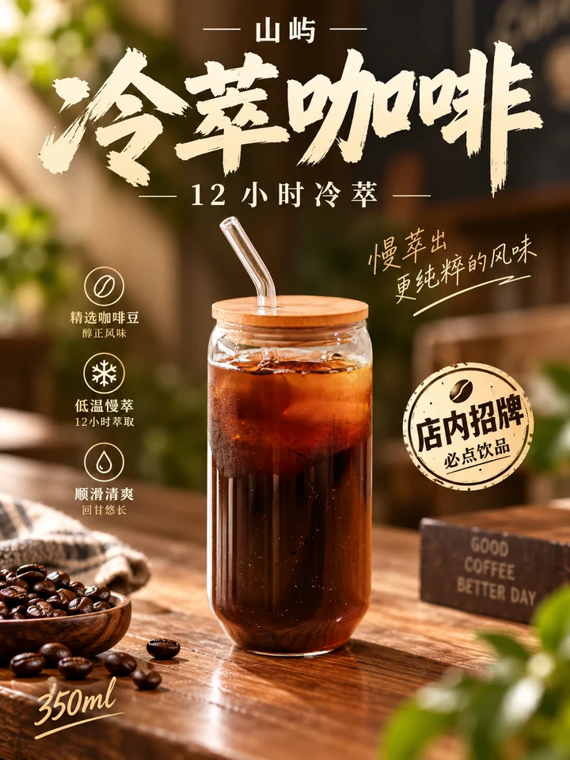</a><br><sub>Menu feature · 3:4 · 1086x1448<br>SHANYU cold brew · <a href="assets/examples/sources/cold-brew.jpg">source photo</a> · brief-generated (Chinese)</sub></td><td align="center" valign="top"><a href="assets/examples/s06-category-1x1-1254x1254.png"></a><br><sub>Delivery-app image · 1:1 · 1254x1254<br>Portuguese egg tart · name only · brief-generated (Chinese)</sub></td><td align="center" valign="top"><a href="assets/examples/s07-category-4x5-1122x1402.png">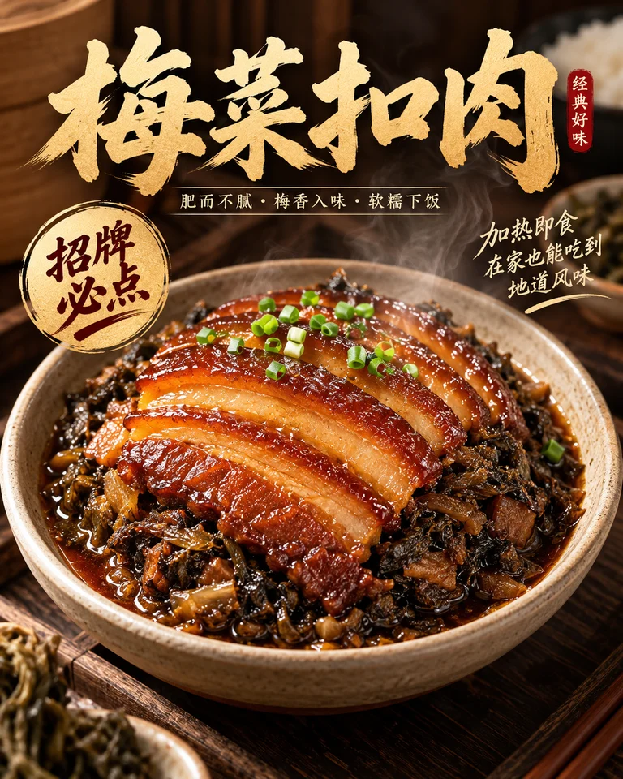</a><br><sub>Listing image · 4:5 · 1122x1402<br>Braised pork with preserved greens · name only · brief-generated (Chinese)</sub></td></tr>
</table>

### The dish name in other languages

<table>
<tr><td align="center" valign="top"><a href="assets/examples/s08-special-1x1-1254x1254.png">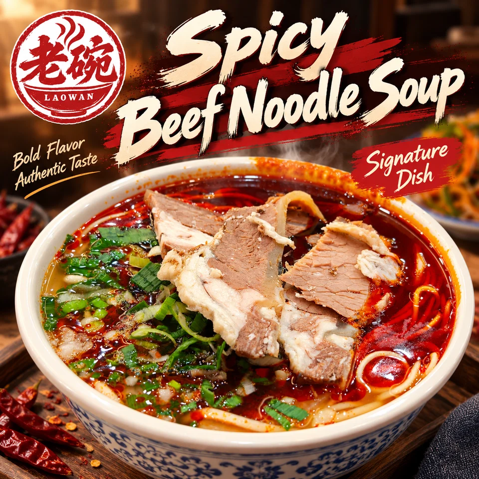</a><br><sub>Delivery-app image · 1:1 · 1254x1254<br>LAOWAN chilli-oil beef noodles · <a href="assets/examples/sources/beef-noodle.jpg">source photo</a> · brief-generated (English)</sub></td><td align="center" valign="top"><a href="assets/examples/s09-special-1x1-1254x1254.png">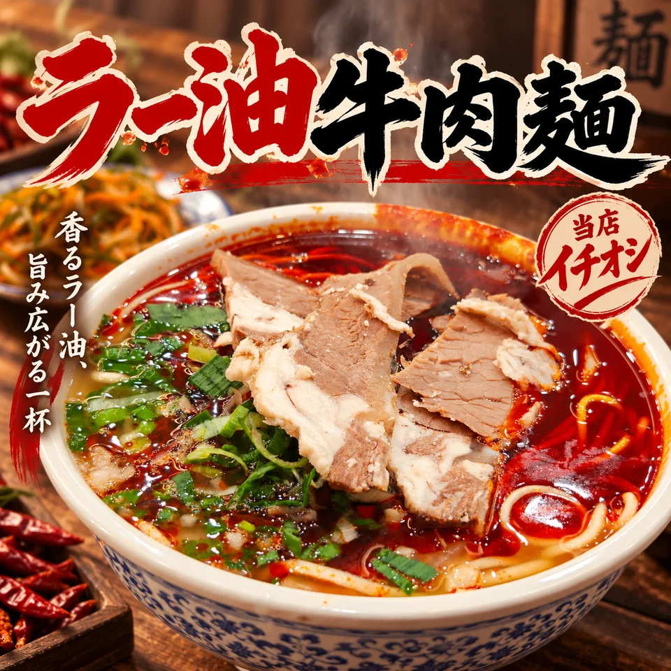</a><br><sub>Delivery-app image · 1:1 · 1254x1254<br>LAOWAN chilli-oil beef noodles · <a href="assets/examples/sources/beef-noodle.jpg">source photo</a> · brief-generated (Japanese)</sub></td></tr>
</table>

<sub>All sample products are fictional demo brands, and their prices and specs are demo values. Source photos come from Unsplash; credits and licence are in [assets/examples/README.md](assets/examples/README.md). Each image is one complete generation: not retouched, composited or upscaled, with its real pixel size shown. Images that failed visual review were regenerated and are not shown. Click for full size.</sub>

<!-- xxd-samples:end -->

## What it solves

On a takeaway app, dozens of dish photos compete for a half-second glance. Good dishes lose for three reasons: a tiny name, food that does not look delicious enough, and stickers that turn into promotional noise.

**Shop 002** orders the image the way a customer decides: the **dish name** is a signboard-grade title, the **food** is the absolute centre, **recommendation stickers** support the judgement, and small text only supplements. In the brief's words: big type hits, stickers judge, small text keeps order.

## What to prepare

- **Dish name** — required; it is one of the two heroes of the image.
- **Dish photo** — recommended; plating, tableware and ingredient ratios are kept. Without one, the dish is built from its name, regional flavour and main ingredients.
- **Facts you allow on the image** — price, portion, founding year, rankings — pass them with `--facts`; nothing else factual appears.

## Where stickers come from

| Sticker | Decided by |
|---|---|
| Signature, must-order, chef's pick, handmade, flavour tags | The model, following the brief |
| New, limited, today's special | Only if you said so |
| Best-seller, popular, top-rated, sales, awards | Only with your `--facts` |

## Getting started

```bash
git clone https://github.com/nevertoday/xxd-shop-002.git
ln -s "$(pwd)/xxd-shop-002" ~/.claude/skills/xxd-shop-002
```

```text
/xxd-shop-002 ./sichuan-pepper-chicken-noodles.jpg --product "Green Sichuan Pepper Chicken Cold Noodles" --use "takeaway listing" --size 1:1 --text prompt --locale en-US
/xxd-shop-002 --product "Chaoshan beef-ball rice-noodle soup" --size 1:1,3:4 --text prompt --locale zh-CN
/xxd-shop-002 ./grilled-fish.jpg --product "Signature grilled fish" --size 2:3 --facts "¥98, serves 2–3; since 2012" --locale zh-CN
```

Key flags: `--product`, `--size`, `--count`, `--text prompt / exact / plan / none`, `--facts`, `--locale`. Full list in the [family runtime](references/shop-runtime.md).

## Boundaries

- The original brief is kept verbatim and is the only aesthetic authority.
- The dish name is never shrunk, ingredients the dish does not have are never added, and sales or ranking claims never appear without your facts.
- PNG output; every invocation creates a fresh task folder.

<!-- xxd-shop-tail -->
## Project structure

```text
xxd-shop-002/
├── SKILL.md
├── README.md / README.en.md
├── LICENSE
├── agents/openai.yaml
├── assets/examples/
├── scripts/
│   ├── configured_imagegen.py
│   └── shop_preferences.py
└── references/
    ├── shop-runtime.md
    ├── runtime-preferences.md
    ├── sample-workflow.md
    └── original-prompt/
        ├── README.md
        ├── zh-CN.md
        └── en.md
```

<!-- xxd-readme-ads:start -->
## About XXD

XXD is Xiaoxiaodong's abbreviated brand name. This project is created and maintained by [@xiaoxiaodong01](https://x.com/xiaoxiaodong01).

## Xiaoxiaodong multi-platform membership · CNY 699/year

> **Advertising disclosure:** The QR code, membership, and paid-service links below are XXD promotional information. Scanning or purchasing is entirely optional and does not affect access to this open-source project.

One annual membership unlocks three benefits together: **Knowledge Planet + the XXD Member Prompt Library + membership for all General Skills**. They are included in one membership; no separate purchase is required.

<!-- xxd-shop-command-system:start -->

### How the Skills work together

| Level | Included | What it does |
|---|---|---|
| **General** | `xxd-shop-all` | Detects available numbered Skills, recommends them by product, placement and visual need, and organizes multi-style and batch tasks. |
| **Soldier** | `xxd-shop-NNN` | Each numbered Skill follows its own original brief and aesthetic to complete the specific task assigned by the General. |

<!-- xxd-shop-command-system:end -->

### What you receive

1. **One-to-one WeChat AI learning and project support**
   Add Xiaoxiaodong on WeChat via the QR code below to discuss AI learning, tools, and real projects one to one, with practical guidance and answers. Representative questions may be organized into member resources.
2. **A growing member prompt library**
   The [XXD Member Prompt Library](https://vip.xiaoxiaodong.ai/) currently contains about 32,000 prompts and will keep expanding, with a goal of exceeding 100,000.
3. **All General Skills and usage support**
   One membership covers every General Skill, with usage guidance and Q&A when you need help.
4. **Priority for high-need requests**
   Frequently requested, high-need prompts and Skills are reviewed and developed first where appropriate.

### How to join

- [Activate membership on the member website](https://vip.xiaoxiaodong.ai/).
- Or scan the QR code below to add Xiaoxiaodong on WeChat for one-to-one activation support.

<p align="center"><a href="https://xiaoxiaodong.pages.dev/assets/wechat-qr.png"></a></p>
<!-- xxd-readme-ads:end -->

## License

This project—including its Skill, prompts, scripts, documentation, and accompanying samples—is released under the **PolyForm Noncommercial License 1.0.0**. The complete legal text is in [LICENSE](LICENSE); the official page is <https://polyformproject.org/licenses/noncommercial/1.0.0>.

In plain language:

- You may use it for personal study, research, experiments, testing, hobbies, and private entertainment. Charities, educational institutions, public research/safety/health organisations, environmental-protection organisations, and government institutions may also use it.
- For **noncommercial purposes**, you may use, copy, modify, create derivative works, and share the project. When sharing, include this license (or the link above) and every `Required Notice:` line supplied by the author.
- Commercial products or services, paid delivery, selling access or licenses, and uses with an anticipated commercial application are not allowed. Obtain separate written permission from the copyright holder for commercial use.
- The license grants only the stated copyright and limited patent rights. It grants no trademark, brand, or other unstated rights, and you may not sublicense or transfer your license.
- If you receive written notice of a violation, you have 32 days to come into full compliance and take practical corrective steps; otherwise the licenses end. A written patent-infringement claim also ends the patent license.
- The project is provided **as is**, without warranties, and you accept the risks and any resulting liability to the extent permitted by law.
